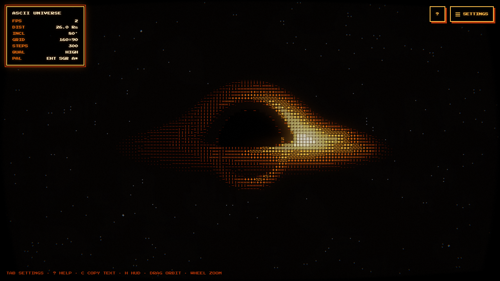
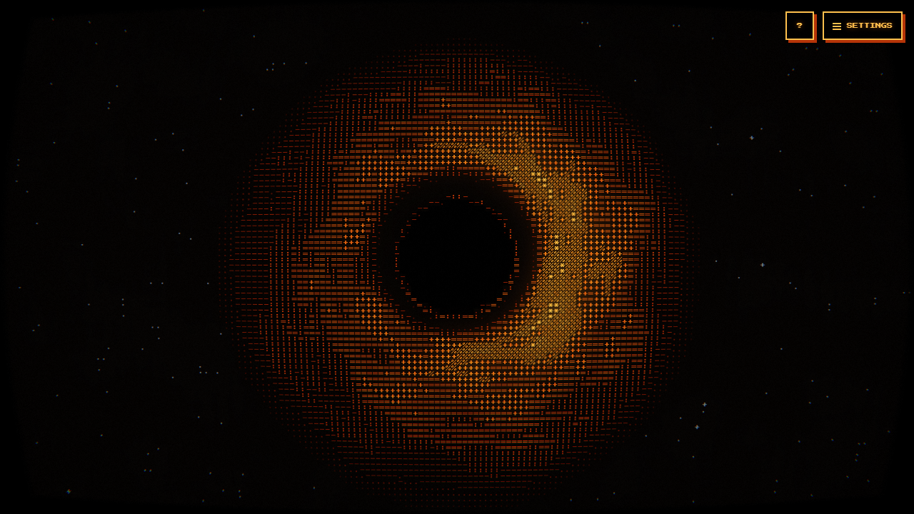
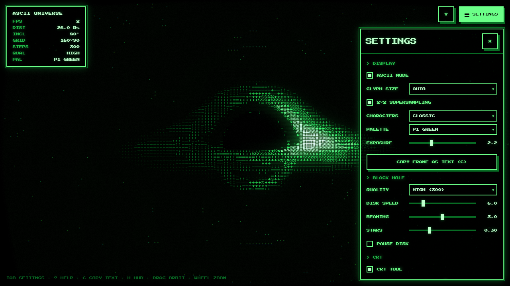
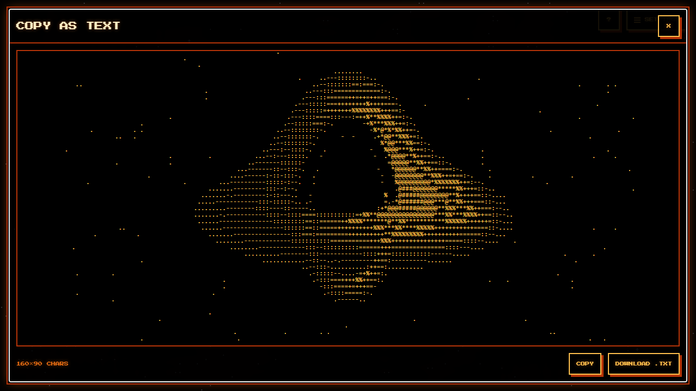

# ASCII Universe

A real-time black hole, ray-traced on your GPU and drawn as retro ASCII art.

Light rays are bent around a Schwarzschild black hole, so you see the far side of the accretion disk
wrapping over and under the shadow, a thin photon ring, and a lensed starfield. The disk is brighter
on the side spinning toward you (Doppler beaming). All of it is rendered at "character resolution"
and drawn with pixel-perfect 8×8 arcade glyphs in a palette inspired by the Event Horizon Telescope
images, with optional CRT effects on top.



| EHT-style view                                               | Settings, green phosphor palette                                  |
| ------------------------------------------------------------ | ----------------------------------------------------------------- |
|  |  |

Press **C** to copy the current frame as plain text. It matches the screen character for character.



## Running it

You need Node 22.12 or newer (there's an `.nvmrc`) and a browser with WebGL 2.

```sh
npm install
npm run dev        # http://localhost:5173
```

Other scripts:

| Script                               | What it does                                    |
| ------------------------------------ | ----------------------------------------------- |
| `npm run build`                      | Type-check and build a static site into `dist/` |
| `npm run preview`                    | Serve the built site locally                    |
| `npm test`                           | Unit tests (vitest)                             |
| `npm run lint` / `npm run typecheck` | ESLint / TypeScript                             |
| `npm run format`                     | Prettier                                        |

`dist/` is plain static files, so any static host works.

## Controls

|            | Mouse                    | Touch       | Keyboard      |
| ---------- | ------------------------ | ----------- | ------------- |
| Orbit      | Drag                     | One finger  | WASD / arrows |
| Pan        | Right-drag or Shift-drag | Two fingers | Shift + WASD  |
| Zoom       | Wheel                    | Pinch       | Z / X, + / −  |
| Roll       |                          | Twist       | Q / E         |
| Reset view | Double-click             | Double-tap  | 0 / Home      |

More keys: **1 2 3** view presets (edge-on, EHT, top-down) · **Space** pause the disk · **C** copy as
text · **[ ]** glyph size · **R** character set · **P** palette · **B** bloom · **T** CRT · **G** ASCII
on/off · **V** debug views · **Tab** settings · **H** HUD · **?** help.

After 30 seconds without input the camera slowly orbits on its own (attract mode). You can turn that
off in settings.

## Settings

Everything is in the settings panel (Tab, or the button top-right) and is saved in your browser:

- **Display:** ASCII mode, glyph size (auto, 1–4×, or an exact column count), 2×2 supersampling,
  character set (classic, dense, blocks, minimal), palette (EHT, afmhot, green phosphor, amber,
  mono), exposure.
- **Black hole:** quality, disk speed, Doppler beaming strength, star density, pause.
- **CRT:** curvature, scanlines, chromatic aberration, vignette, phosphor mask and flicker, each with
  its own strength, plus bloom.
- **Camera:** presets, attract mode, HUD.

**Quality** sets how many steps each light ray takes: Low 96, Medium 160, High 300, Ultra 500. The
default, **Auto**, watches the frame rate and steps down when it drops (fewer ray steps first, then
no supersampling, then bigger glyphs), and back up when there's headroom. The HUD shows the current
level, e.g. `AUTO·MED`. Phones and tablets start lighter: no supersampling, fewer CRT effects, and a
lower starting quality.

## How it works

Each frame runs a few full-screen shader passes (plain Three.js, no scene graph):

1. **Scene** (`src/shaders/blackhole.frag`): one ray per character cell (2×2 with supersampling)
   into a small float texture. Rays follow Schwarzschild null geodesics using the exact
   acceleration `a = −1.5·h²·x/r⁵` (units where the Schwarzschild radius is 1), stepped with an
   adaptive leapfrog integrator. Each time a ray crosses the disk plane it picks up emission, up to
   three crossings, which gives the secondary image and the photon ring. Escaped rays sample the
   starfield in their bent direction, so the stars are lensed for free.
2. **Disk:** Novikov–Thorne brightness profile × (Doppler × gravitational redshift)^beaming, with
   Keplerian-sheared noise for the swirl. Two noise layers crossfade so the shear never winds the
   pattern into thin rings.
3. **Bloom:** a small blur at cell resolution for phosphor glow.
4. **ASCII** (`src/shaders/ascii.frag`): brightness → tonemap → glyph from a ramp sorted by measured
   ink coverage, coloured through a 256-entry palette texture. Glyphs come from Press Start 2P,
   rasterised to 1-bit at load time.
5. **CRT** (`src/shaders/crt.frag`): curvature, aberration, scanlines aligned to glyph pixels,
   mask, vignette, flicker. Skipped entirely when everything is off.

Copy as text reads the glyph indices back through the same mapping code
(`src/shaders/lib/glyphmap.glsl`), which is why it always matches the screen.

The palette maps _brightness_ to colour, like the EHT images (their colours show radio brightness
temperature, not visible light). Simplifications: the hole doesn't spin (no Kerr), and the disk is
infinitely thin.

React only handles the UI. The render loop reads settings straight from a zustand store each frame,
so moving a slider never re-renders the canvas component.

```
src/
  renderer/   Engine (render loop), passes, camera + input, glyph atlas, palettes, quality governor
  shaders/    GLSL passes and shared includes
  state/      settings (persisted), stats, UI state, commands
  ui/         HUD, settings panel, help, boot screen, copy-as-text, overlays
tests/        geodesics, camera, glyphs, palettes, grid, settings, quality governor, text export
```

## Credits

- Font: [Press Start 2P](https://fonts.google.com/specimen/Press+Start+2P) by CodeMan38 (OFL),
  bundled via `@fontsource/press-start-2p`.
- Colour inspiration: the Event Horizon Telescope images of M87\* and Sgr A\*.
